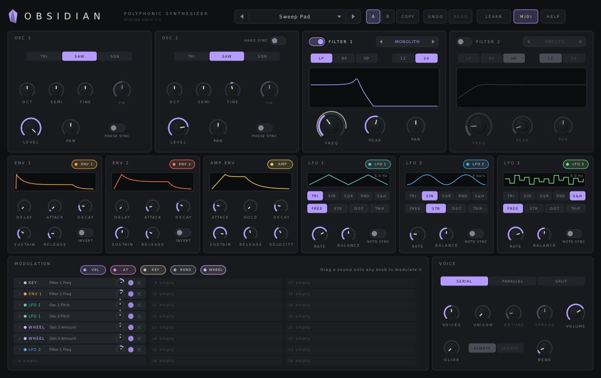
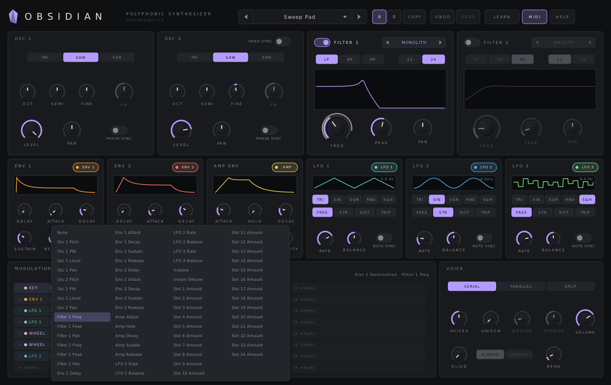

# Obsidian

**A polyphonic two-oscillator, two-filter synthesizer plugin for macOS, Windows and Linux (VST3 · AU · CLAP · VST2).**

Part of **[Epsilon Audio](https://github.com/natehouk/epsilon-plugins)**, a family of free, open-source plugins: Monolith, Caldera, Obsidian, Strata, Basalt, Gneiss, Mica, Flint, Granite, Magma, Schist and Slate.



Obsidian is a clean-room design with the feature set of FabFilter Twin, FabFilter's third plugin (December 2005). It was written from scratch, working only from FabFilter's public press release and contemporary reviews. No FabFilter code, binaries, presets, artwork or trademarks were used.

It is the third instrument in a family:
- [Monolith](https://github.com/natehouk/monolith), a synth
- [Caldera](https://github.com/natehouk/caldera), a filter effect
- **Obsidian**, which shares their filter design. Monolith's filter is one of its four styles.

## Download

Get the latest build from [**Releases**](../../releases):

| Platform | File | Contains |
|---|---|---|
| macOS 10.13+ (Apple Silicon + Intel) | `Obsidian-macos-universal.zip` | VST3, AU, CLAP |
| Windows x64 | `Obsidian-windows-x64.zip` | VST3, CLAP, VST2 |
| Linux x64 | `Obsidian-linux-x64.zip` | VST3, CLAP, VST2 |

### Install

| Platform | Copy | To |
|---|---|---|
| macOS | `Obsidian.vst3` / `Obsidian.component` / `Obsidian.clap` | `~/Library/Audio/Plug-Ins/VST3` / `Components` / `CLAP` |
| Windows | `Obsidian.vst3` (folder) / `Obsidian.clap` | `C:\Program Files\Common Files\VST3\` / `CLAP\` |
| Linux | `Obsidian.vst3` / `Obsidian.clap` | `~/.vst3/` / `~/.clap/` |

**macOS:** the plugins are ad-hoc signed, not notarized. After copying, run:

```
xattr -dr com.apple.quarantine ~/Library/Audio/Plug-Ins/*/Obsidian*
```

## Features

**Oscillators (2)**
- **Triangle, saw or square**, band-limited with PolyBLEP.
- **Pulse width** for the square wave.
- **Octave** (±3), **semitone** (±12), **fine** (±100 cents).
- **Level** and stereo **pan**.
- **Phase sync**: each note starts the oscillator at the same point, which helps punchy basses. When it's off, each note starts at a random point.
- **Hard sync**: oscillator 2 restarts every cycle of oscillator 1.

**Filters (2)**
- Each filter can be switched on or off independently.
- **Four styles:**

  | Style | Character |
  |---|---|
  | **Smooth** | Moderate overdrive, broad resonance |
  | **Hot** | Saturating, screaming peak |
  | **Raw** | Buzzy, self-oscillating |
  | **Monolith** | The Monolith synth's filter, self-oscillating |

- **Low / band / high pass** at **12 or 24 dB/oct**.
- **Freq**, **Peak** (resonance) and stereo **Pan**: pan offsets the cutoff between the left and right channels.
- **Routing:**
  - **Serial**: both oscillators feed filter 1, then filter 2.
  - **Parallel**: both oscillators feed both filters, and their outputs are summed.
  - **Split**: oscillator 1 feeds filter 1, and oscillator 2 feeds filter 2.

**Envelopes (3)**
- **Env 1** and **Env 2** are for modulation: **delay**, attack, decay, sustain, release, and an **invert** switch.
- **Amp Env** controls each voice's volume. It has a **hold** stage, which keeps the note at full level after the attack, before the decay starts. Its **Velocity** knob sets how much velocity affects volume.
- Every envelope parameter can be a modulation destination.

**LFOs (3)**
- Waves: **triangle, sine, square, random** (smoothly gliding between random values) and **sample & hold**.
- **Balance** skews triangle and sine from a falling ramp to a rising ramp. For square, it sets the duty cycle.
- **Free** (0.01–50 Hz) or synced to host tempo and song position: **straight, dotted or triplet**, 16 bars to 1/64.
- **Note sync** restarts the LFO for each note, giving every voice its own LFO.
- Rate and balance can both be modulation destinations.

**Modulation: 24 slots, drag and drop**
- Drag a **source chip** onto any knob. A slot is created with a sensible starting amount, and the knob gets a coloured ring showing it's modulated.
  - The chips for LFO 1–3, Env 1–2 and Amp Env sit on their own panels.
  - The chips for **Velocity, Aftertouch** (channel or polyphonic), **Key Track, Pitch Bend** and **Mod Wheel** sit on the Modulation panel.
- Each slot has:
  - a source picker
  - a destination picker
  - a bipolar **amount** knob (turn it left to invert)
  - a **bypass** switch
  - a delete button
- Every slot's amount is itself a destination, so a slot can control how much another slot modulates. In the Init preset, the mod wheel brings in vibrato this way.
- Destinations:
  - oscillator pitch, PW, level and pan
  - filter freq, peak and pan
  - every envelope stage
  - LFO rate and balance
  - volume, unison detune, and every slot's amount
- Freq modulation reaches ±5 octaves, and pitch modulation ±24 semitones. With **Key Track → Filter Freq** at 20%, the filter tracks the keyboard 1:1.



**Voices**
- **Voices** (1–24): at 1, the synth plays monophonically with last-note priority.
- **Unison** (1–4 voices per note) with **detune** and stereo **spread**. The total is capped at 24 voices; the oldest note is retired first, released notes before held ones.
- **Glide** works in mono and poly. **Always** glides on every note. **Legato** glides only when notes overlap, and in mono it doesn't retrigger the envelopes.
- Pitch-bend range up to ±24 st, sustain pedal (CC64), all-notes-off and all-sound-off.

**Workflow** (shared with Caldera)
- **MIDI Learn:**
  1. Click **LEARN**.
  2. Click a control, then move a knob or fader on your controller.
  3. Right-click a control to unassign it, or use **Clear all CCs**.

  Assignments are saved with your project.
- **MIDI** switch: turns all MIDI handling off.
- **42 factory presets** in six categories: Bass, Lead, Pad, Keys & Plucks, Brass & Strings, FX & Motion.
- **Save your own presets** as small text files, which load the same on every OS:
  - macOS: `~/Library/Audio/Presets/Epsilon Audio/Obsidian/`
  - Windows: `%APPDATA%\Epsilon Audio\Obsidian\Presets\`
  - Linux: `~/.config/epsilon-audio/obsidian/presets/`
- To delete a user preset, right-click it in the menu, then click it again to confirm.
- **Resizable** window, double-click to **type a value**, **Cmd/Ctrl-click** to reset a control, and hover a control to see its name and value.

### Compared with FabFilter Twin (2005)

| Twin | Obsidian |
|---|---|
| 2 oscillators: triangle / saw / square, PW, hard sync, phase sync, pan | ✓ |
| 2 multimode filters, LP/HP/BP, 12/24 dB, 3 characters + One's filter, per-filter pan | ✓ (Smooth, Hot, Raw + Monolith's filter) |
| Several oscillator → filter routings | ✓ serial, parallel, split |
| 3 envelopes with delay / hold, invertible, all parameters modulatable | ✓ |
| 3 LFOs: triangle, sine, square, random triangle, S&H; sync straight/dotted/triplet; note sync; balance | ✓ |
| 24 drag-and-drop modulation slots, invertible, bypassable, slot levels modulatable | ✓ |
| Sources: LFOs, envelopes, velocity, aftertouch, key track, pitch bend, mod wheel | ✓ |
| 24 voices with unison, polyphonic portamento | ✓ |
| MIDI Learn | ✓ |
| 500+ factory presets | 42, plus saving your own |
| Pro Tools (RTAS/AAX) | Not supported (needs Avid's SDK and signing) |

## Build from source

The plugin is built on [DPF](https://github.com/DISTRHO/DPF):

```
git clone --recursive https://github.com/DISTRHO/DPF.git dpf
make -C plugins/Obsidian                    # Linux / macOS (macOS also builds the AU)
make -C plugins/Obsidian WINDOWS=true CC=x86_64-w64-mingw32-gcc CXX=x86_64-w64-mingw32-g++
```

GitHub Actions builds all three platforms on every push. The macOS build is universal and ad-hoc signed. A `v*` tag, or a release published on GitHub, attaches the zips to that release.

## Tests

```
cd tests
g++ -O2 -std=c++11 features.cpp -o features && ./features   # voices/unison/stealing, mono, hard & phase sync, routing, slots, slot-on-slot, delay, hold, S&H, filter styles, glide
g++ -O2 -std=c++11 fuzz.cpp -o fuzz && ./fuzz               # random params/MIDI/transport at 44.1–192 kHz: finite, <= 0 dBFS
g++ -O2 -std=c++11 presets.cpp -o presets && ./presets      # plays every factory preset
g++ -O3 -std=c++11 bench.cpp -o bench && ./bench            # CPU: 24 voices, both 24 dB filters, all LFOs
```

At full load (24 voices, both filters at 24 dB, three LFOs and several slots running), Obsidian uses about 20% of one CPU core. Normal playing uses much less.

Release checks:
- Steinberg's VST3 validator passes 47/47.
- The interface is exercised with scripted input, including drag-and-drop modulation, the slot pickers, MIDI Learn and presets.

## Source layout

| File | Contents |
|---|---|
| `plugins/Obsidian/ObsidianEngine.hpp` | All DSP: voices, oscillators, filters, envelopes, LFOs, modulation matrix. Header-only |
| `plugins/Obsidian/ParamDefs.hpp` | Parameter table, labels, modulation source and destination names, value mapping |
| `plugins/Obsidian/Presets.hpp` | Factory presets |
| `plugins/Obsidian/UserPresets.hpp` | User preset files |
| `plugins/Obsidian/ObsidianPlugin.cpp` | Plugin wrapper: parameters, programs, MIDI, MIDI Learn, transport |
| `plugins/Obsidian/ObsidianUI.cpp` | Custom vector interface (NanoVG) |

New parameters are only ever appended, so saved sessions and automation keep working across versions.

## License

[MIT](LICENSE). Built with [DPF](https://github.com/DISTRHO/DPF) and its bundled NanoVG, which are under the ISC license. `plugins/Obsidian/ResizeHandle.hpp` comes from DPF's examples and keeps its ISC notice.

"FabFilter" and "FabFilter Twin" are trademarks of FabFilter Software Instruments. Obsidian is not affiliated with or endorsed by FabFilter.
