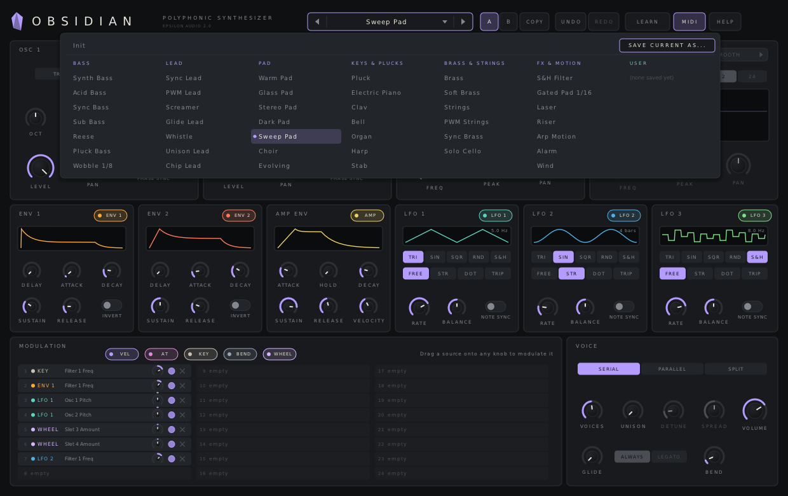
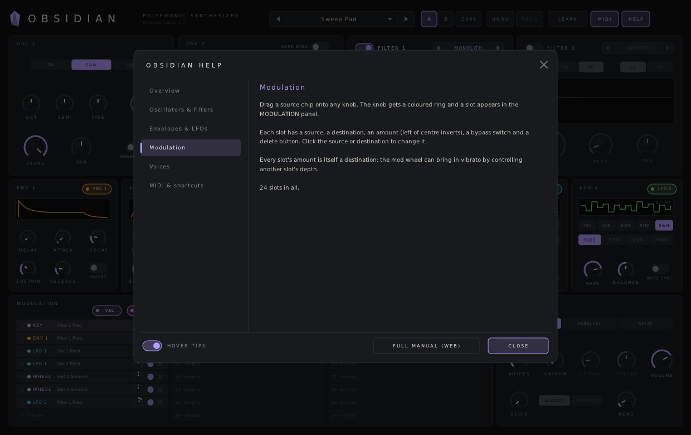

# Obsidian 3.1 — User Manual

Obsidian is a polyphonic synthesizer. It has:

- four oscillators with noise, ring modulation, sync and analog drift
- four filters in eleven styles, with EQ shapes and three routings
- an effects section: reverb, delay, chorus, phaser/flanger, drive and compressor
- an arpeggiator
- drag-and-drop modulation: four XLFOs (also step sequencers), two curved envelope generators, two envelope followers, two XY pads and the MIDI sources, in up to 100 slots

It plays up to 64 voices, with unison, glide and a per-oscillator voice mode. Typical uses:

- warm, wide and evolving pads, strings and brass
- sync, ring and unison leads; basses
- keys, plucks and bells
- arpeggios, sequences and rhythmic motion

Obsidian runs as VST3, AU, CLAP and VST2 on macOS, Windows and Linux.

**Contents**

1. [Installing](#1-installing)
2. [A quick tour](#2-a-quick-tour)
3. [The oscillators](#3-the-oscillators)
4. [The filters](#4-the-filters)
5. [The amp envelope](#5-the-amp-envelope)
6. [Voices](#6-voices)
7. [Effects](#7-effects)
8. [The arpeggiator](#8-the-arpeggiator)
9. [Modulation sources](#9-modulation-sources)
10. [Modulation slots](#10-modulation-slots)
11. [Knobs](#11-knobs)
12. [A/B, undo and redo](#12-ab-undo-and-redo)
13. [MIDI](#13-midi)
14. [Presets](#14-presets)
15. [Help and hover tips](#15-help-and-hover-tips)
16. [Recipes](#16-recipes)
17. [Parameter reference](#17-parameter-reference)
18. [Compatibility with Obsidian 2](#18-compatibility-with-obsidian-2)
19. [Troubleshooting](#19-troubleshooting)

---

## 1. Installing

Download the zip for your system from the project's **Releases** page and copy the plugin files:

| System | Copy | To |
|---|---|---|
| macOS | `Obsidian.vst3`, `Obsidian.component` (AU), `Obsidian.clap` | `~/Library/Audio/Plug-Ins/VST3`, `.../Components`, `.../CLAP` |
| Windows | the `Obsidian.vst3` folder, `Obsidian.clap` | `C:\Program Files\Common Files\VST3\`, `...\CLAP\` |
| Linux | `Obsidian.vst3`, `Obsidian.clap` | `~/.vst3/`, `~/.clap/` |

**macOS:** if the build isn't notarized and macOS blocks it, open Terminal and run:

```
xattr -dr com.apple.quarantine ~/Library/Audio/Plug-Ins/*/Obsidian*
```

Rescan plugins in your DAW. Obsidian appears under **Epsilon Audio** as an instrument.

Projects saved with Obsidian 1.x and 2.x open unchanged and sound identical in 3.0 (see [section 18](#18-compatibility-with-obsidian-2)).

---

## 2. A quick tour


- **Header:** the preset browser, **A / B** and **COPY**, **UNDO / REDO**, **LEARN** (MIDI Learn), **MIDI** on/off and **HELP**. When HQ is on, the latency is shown at the far right.
- **Top row:** **OSCILLATORS** (four columns) and **FILTERS** (tabs F1–F4, the response display and the selected filter's controls).
- **Middle row:** **AMP ENVELOPE**, **VOICE** and **EFFECTS**.
- **Bottom row:**
  - **Sources:** tabs for XLFO 1–4, EG 1–2, EF 1–2, XY 1–2, MIDI, and the classic LFO 1–3 and ENV 1–2. Each tab has its source chips.
  - **MODULATION:** the list of every connection.
  - **ARPEGGIATOR.**
- **Status line** (bottom): the name and value of whatever is under the pointer.

---

## 3. The oscillators

Each of the four oscillators has an on switch (next to its number) and:

- **Wave** (click the arrows or scroll): **TRI**, **SAW**, **SQUARE**, **SINE**, **WHITE** noise or **PINK** noise. The tones are band-limited, so high notes don't alias.
- **OCT** (±3), **SEMI** (±12) and **FINE** (±100 cents).
- **LEVEL**, **PAN** and **PW** (pulse width, for the square only; greyed out otherwise).
- **SYNC:** a frequency ratio from **Off** (×1) to ×16. The oscillator is hard-synced to a hidden master running at the note's pitch, while itself running at the ratio. Turning SYNC up, or modulating it, gives the classic tearing sync sweep without needing a second oscillator.
- **PHASE:** on, every note starts the oscillator at the same point, for consistent, punchy attacks. Off, each note starts at a random point, which sounds looser and wider.

Oscillator 2 also keeps Obsidian 2's **1>2 SYNC** switch, which restarts oscillator 2 each time oscillator 1 starts a cycle.

**Ring modulation.** The round **×** buttons between oscillators 1 and 2, and between 3 and 4, turn on ring modulation: the second oscillator of the pair is multiplied by the first. Metallic, bell-like and clangorous tones; detune the pair for movement.

The display above each column draws the wave, including the effect of SYNC and ring modulation.

---

## 4. The filters

There are four filters. Click a tab (**F1–F4**) to edit that filter; click the dot on the tab to switch the filter on or off. In the display you can also:

- **drag a numbered handle:** left/right sets the frequency, up/down sets the peak (or, for bell and shelf shapes, the gain); hold **Shift** for fine moves
- **scroll over a handle:** changes the peak or gain
- **double-click empty space:** switches on the next free filter at that frequency
- **right-click a handle:** switches that filter off

Each filter's curve is drawn in its colour; with two or more filters on, a white line shows the combined response.

**Style** (click the box to pick one):

| Style | Character |
|---|---|
| **Smooth** | Moderate overdrive, broad resonance |
| **Hot** | Saturating, with a screaming peak |
| **Raw** | Buzzy, self-oscillating |
| **Monolith** | The Monolith synth's filter, self-oscillating |
| **Clean** | Linear and transparent; never self-oscillates. Best for precise EQ shapes |
| **Warm** | A saturated input into a linear filter; rounded, never harsh |
| **Acid** | Resonance thins out the bass; squelchy and rubbery |
| **Tube** | An asymmetric, valve-like input stage; warm overdrive, mostly even harmonics |
| **Gentle** | Clean, polite and broad |
| **Metal** | Hard-clipped input and feedback; rough and sharp |
| **Hollow** | The band at the cutoff is carved out as the peak rises; nasal and vocal |

**Controls**
- **Shape:** **LP**, **BP**, **HP**, **BELL**, **LO SH** (low shelf), **HI SH** (high shelf) or **NOTCH**.
- **Slope:** 6, 12, 24 or 48 dB per octave.
- **FREQ:** 20 Hz to 20 kHz.
- **PEAK:** resonance; for bell, shelf and notch shapes it sets how narrow the shape is.
- **GAIN:** ±24 dB, for the bell and shelf shapes.
- **PAN:** offsets the cutoff between the left and right channels.
- **FREQ OFS** and **PEAK OFS** move the frequency (±5 octaves) and peak of **all four filters** at once. They are ideal modulation targets for a whole-filter sweep.

**Routing** (top right of the panel):
- **SERIAL:** all oscillators go through each filter that is on, in turn.
- **PARALLEL:** all oscillators feed every filter that is on, and the outputs are summed.
- **PER OSC:** oscillator 1 feeds filter 1, oscillator 2 feeds filter 2, and so on. An oscillator whose filter is off goes straight to the output.

**HQ** (in the VOICE panel) runs the voices at 4× the sample rate, which removes aliasing from screaming filters and heavy sync at the cost of CPU and about 0.5 ms of latency (reported to the host, which compensates).

---

## 5. The amp envelope

**AMP ENVELOPE** shapes each voice's volume:

- **ATTACK**, **HOLD**, **DECAY**, **SUSTAIN**, **RELEASE**; HOLD keeps the note at full level after the attack.
- **VEL:** how much velocity changes the volume.

The amp envelope is also a modulation source (the **AMP** chip on the ENV 1-2 tab), and every stage is a modulation destination.

---

## 6. Voices

- **VOICES** (1–64): how many notes sound at once. At 1, Obsidian is monophonic, with last-note priority.
- **UNISON** (1–8): stacks voices on every note. **DETUNE** spreads their pitch and **SPREAD** their stereo position. The oldest note is retired first when voices run out, released notes before held ones.
- **GLIDE:** slides between notes, in mono and poly. With **LEGATO** off it glides on every note; on, it glides only when notes overlap, and in mono doesn't restart the envelopes.
- **PER OSC:** each new note goes to the next oscillator in turn (with oscillators that are off skipped), so a chord is spread across the oscillators, each with its own settings: a different wave, octave, level or filter (with PER OSC routing).
- **BEND:** the pitch-bend range, up to 24 semitones.
- **TUNE** (±100 cents) and **OCTAVE** (±3): master tuning and transposition.
- **DRIFT:** slow, random pitch wander per voice and oscillator, like an analog synth warming up. A little thickens pads; a lot sounds worn.
- **VOLUME:** the output level.
- The **sustain pedal** (CC64) holds notes. All Notes Off and All Sound Off are honoured.

---

## 7. Effects

The effects process the whole synth, in this order: **drive (pre)** → **reverb** → **delay** → **chorus** → **phaser** → **drive (post)** → **compressor**.

Each unit in the EFFECTS panel has an on switch and its main knob. Click a unit's name to show its other settings on the right.

| Unit | Main knob | Settings |
|---|---|---|
| **REVERB** | AMOUNT | **TIME** 0.2–20 s, **BRIGHT** (brightness of the tail), **PREDELAY** 0–250 ms |
| **DELAY** | AMOUNT | **TIME** 1 ms–2 s, or a note length when **SYNC** is on (1/4 to 1/32, dotted and triplet, 1/2); **FEEDBACK**; **OFFSET** (left/right time difference); **LOW CUT** and **HIGH CUT** on the repeats; **PING-PONG** |
| **CHORUS** | AMOUNT | **SINGLE** or **DOUBLE** (two voices, wider); **RATE**, **DEPTH**, **DELAY** 2–30 ms |
| **PHASER** | AMOUNT | **PHASER** or **FLANGER**; **RATE**, **DEPTH**, **FEEDBACK**, **SHIFT** (left/right offset) |
| **DRIVE** | DRIVE | **PRE** (before every effect) or **POST** (after the modulation effects, before the compressor) |
| **COMP** | THRESH | **RATIO** 1:1–20:1, **ATTACK**, **RELEASE**, **AMOUNT** (parallel mix), **AUTO GAIN**; a meter under the unit shows the gain reduction |

The main knobs, and several settings, are modulation destinations. Because the effects process the whole synth, their modulation follows the most recently played note's sources.

---

## 8. The arpeggiator

Switch the arpeggiator **ON** and hold a chord: it plays the notes one at a time.

- **ORDER:** **UP**, **DOWN**, **UP/DN**, **PLAYED** (the order you pressed the keys) or **RANDOM**.
- **OCTAVES:** 0 to +3 extra octaves.
- **RATE:** 0.25–20 Hz, or with **SYNC** on, a note length locked to the host tempo. **OFFSET** (×0.5 to ×2) speeds up or slows down the synced rate.
- **GROOVE:** pushes every second note later (positive) or earlier (negative), for swing.
- **LEGATO:** the note length, from short and staccato to tied notes.
- **LATCH:**
  - **OFF:** the arpeggio stops when you let go.
  - **HELD:** a chord keeps playing after you let go; a new chord replaces it.
  - **FULL:** every note you play keeps playing; a new chord after you let go replaces them.
- **RETRIG:** restarts the pattern from its first note when you play a new chord.
- **LOCK:** keeps the arpeggiator settings when you load another preset, so you can audition sounds with the same pattern.

The display shows the pattern, with the note that is playing lit up.

**PRESETS** (next to the title) loads a ready-made arpeggio (order, octaves, note length, groove, latch and rate) without touching the sound, or saves your own.

---

## 9. Modulation sources

Each tab in the sources panel has coloured **source chips**. Drag a chip onto a knob to modulate it ([section 10](#10-modulation-slots)). The small bar in each chip shows the source moving. A dot on a tab means that source is in use.

**XLFO 1–4.** Flexible LFOs with two modes:
- **WAVE:** **SIN**, **TRI**, **SAW+**, **SAW−**, **SQR**, **RND** (gliding random) or **S&H**; **BALANCE** skews the shape.
- **STEPS:** a 16-step sequencer. Draw the steps in the display (Cmd/Ctrl-click resets a step to zero), set how many steps play, and **GLIDE** between them.
- **Tempo sync:** **FREE** (RATE 0.01–50 Hz) or **SYNC**, **DOTTED** or **TRIPLET** (16 bars to 1/64).
- **PER NOTE:** on, each note gets its own XLFO, restarted at the note. Off, one XLFO is shared by all voices and keeps running, like a global LFO.
- **LFO PRESETS** loads one of the factory shapes, or saves and loads your own.

**EG 1–2.** Envelope generators with **ATTACK**, **DECAY**, **SUSTAIN** and **RELEASE**, and three **curve handles** in the display: drag a handle up or down to bend that stage from logarithmic through linear to exponential. **TRIGGER**: **NOTE** restarts the envelope for each note; **LEGATO** lets an overlapping note carry on from where the envelope was.

**EF 1–2.** Envelope followers: they turn loudness into modulation. **LISTENS TO**: **VOICE** follows each voice's own output, **SYNTH** follows the whole synth. **ATTACK**, **RELEASE** and **GAIN** set the response; **TRANSIENT** makes it react only to attacks, for snappy accents.

**XY 1–2.** Two pads, each with an X and a Y chip. Drag the dot, automate it, or MIDI-learn it, to morph several things at once.

**MIDI.** **VEL** (velocity), **KEY** (key tracking, around middle C), **WHEEL** (mod wheel), **BEND** (pitch bend) and **AT** (channel or polyphonic aftertouch).

**LFO 1-3 and ENV 1-2 (classic).** Obsidian 2's three LFOs and two delay/invert envelopes, plus the **AMP** envelope chip. They feed the 24 classic slots, which reach the destinations Obsidian 2 could modulate; sounds made in Obsidian 2 keep using them.

---

## 10. Modulation slots

**Drag and drop**
- Drag a **source chip** onto any knob. A slot is created with a sensible starting amount, and the knob gets a coloured ring showing the range; a white dot on the ring shows the modulation moving.
- **Right-click a knob**, or click its ring, to list everything that modulates it, with amounts, bypass and delete.

**The MODULATION list** shows every connection: up to **100** new slots, plus Obsidian 2's 24 classic slots (shaded). Each row has:
- a **source**: click to pick another
- a **destination**: click to pick another
- an **amount**: drag it; turning it left inverts. Cmd/Ctrl-click resets it
- a **bypass** switch
- a **delete** button

Scroll the list when it's longer than the panel.

**Destinations**
- every oscillator's pitch, PW, level, pan and sync ratio; master tune and glide; unison spread
- every filter's freq, peak, pan and gain; the freq and peak offsets
- the effects' amounts, reverb time, brightness and predelay, delay time and feedback, chorus and phaser rate and depth, phaser feedback, drive, compressor threshold and amount
- the arpeggiator rate
- the XLFOs' rate and balance; the EGs' stages
- **every slot's amount**, so one slot can control how much another modulates
- everything Obsidian 2 could modulate (through its classic sources)

**Ranges:** filter frequency modulation reaches ±5 octaves, and pitch modulation ±24 semitones. With **KEY → Filter Freq** at 20%, the filter tracks the keyboard 1:1.


---

## 11. Knobs

- **Drag** up or down; hold **Shift** for fine adjustment.
- **Grab the rim** of a large knob to turn it in a circle.
- **Mouse wheel** turns a knob; over a stepper, it steps.
- **Double-click** to type a value: `1.2k`, `L40`, `-6`, `250ms`, `+7`. **Enter** applies it, **Esc** cancels.
- **Cmd/Ctrl-click** resets to the default.

---

## 12. A/B, undo and redo

- **A / B** hold two complete sounds, modulation included. Click the other letter to switch; the first time, B starts as a copy of A.
- **COPY** copies the current sound into the other slot.
- Every edit is an undo step, including new modulation, preset loads and A/B switches. Obsidian remembers the last 200.
  - Undo: **UNDO**, or Cmd/Ctrl-Z
  - Redo: **REDO**, or Cmd/Ctrl-Shift-Z or Cmd/Ctrl-Y

---

## 13. MIDI

**MIDI Learn**
1. Click **LEARN**.
2. Click a knob, switch, filter tab or ring-mod button.
3. Move a knob or fader on your controller.
4. Click **LEARN** again (or press Esc) to finish.

- Right-click a control to unassign it.
- **CLEAR ALL CCs** (in the status line while learning) removes them all.
- Assignments are saved with your project.
- A learned controller replaces that controller's usual job (for example, CC1 as the mod wheel).

**The MIDI button** switches all MIDI input off, notes included. Leave it on to play Obsidian.

---

## 14. Presets

There are 60 factory sounds in eight groups, plus your own:

| Group | Presets |
|---|---|
| Bass | Synth Bass, Acid Bass, Sync Bass, Sub Bass, Reese, Pluck Bass, Wobble 1/8, Four-Osc Bass, Reese Drift |
| Lead | Sync Lead, PWM Lead, Screamer, Glide Lead, Whistle, Unison Lead, Chip Lead, Hollow Sync Lead, Ring Lead, HQ Screamer |
| Pad | Warm Pad, Glass Pad, Stereo Pad, Dark Pad, Sweep Pad, Choir, Evolving, Shimmer Pad, Breathing Pad (XY) |
| Keys & Plucks | Pluck, Electric Piano, Clav, Bell, Organ, Harp, Stab, Tine Keys, Vowel Keys (Wheel), Transient Pluck |
| Brass & Strings | Brass, Soft Brass, Strings, PWM Strings, Sync Brass, Solo Cello |
| FX & Motion | S&H Filter, Gated Pad 1/16, Laser, Riser, Arp Motion, Alarm, Wind, Noise Sweep |
| Arp & Sequence | Arp Up 1/16, Random Arp, Groove Arp (Latch), Step Filter Bass, Trance Gate |
| Texture | Per-Osc Chords, Drift Strings |

**Init** is a plain starting point, with key tracking, a filter envelope and mod-wheel vibrato already set up.

**Browsing**
- Click the preset name to open the browser.
- **◀ ▶**, or the mouse wheel over the name, step through factory and user presets.
- **Search:** with the browser open, just type: the list narrows to presets whose name or category matches. Backspace edits, Esc clears the search (and then closes the browser).
- **Favourites:** click the star at the right of any preset to add it to the FAVOURITES column; click again to remove it. Favourites are kept in `favourites.txt` in your presets folder.
- A `*` after the name means you have changed the sound since loading it.
- With the arpeggiator's **LOCK** on, presets load without changing the arpeggiator.

**Your own presets**
- **SAVE CURRENT AS…** stores your own sounds, in one of these folders:
  - macOS: `~/Library/Audio/Presets/Epsilon Audio/Obsidian`
  - Windows: `%APPDATA%\Epsilon Audio\Obsidian\Presets`
  - Linux: `~/.config/epsilon-audio/obsidian/presets`
- Preset files are plain text and work on every system. Presets saved in Obsidian 2 load unchanged.
- To delete one, right-click it in the browser and click again to confirm.

**Section presets.** The **LFO PRESETS**, **EG PRESETS** and **EF PRESETS** menus on the XLFO, EG and EF tabs, and **PRESETS** in the arpeggiator, load and save just that section's settings, so a favourite shape, envelope or pattern can be reused in any sound. They are stored in `LFO`, `Envelope`, `Follower` and `Arpeggiator` folders inside your presets folder.



---

## 15. Help and hover tips

- Rest the pointer on any control, chip, display or header button to see what it does and its current value.
- **HELP** opens the in-plugin pages. The switch at the bottom of the help window turns hover tips on or off.
- **FULL MANUAL (WEB)** opens this manual.



---

## 16. Recipes

- **Sync sweep:** OSC 1 SAW; drag EG 1 onto its **SYNC** knob and raise the amount. Add HQ for the cleanest top end.
- **Four-oscillator supersaw:** all four oscillators SAW, FINE −12, −4, +4, +12, PAN spread; UNISON 2, DRIFT 30%; reverb and chorus on.
- **Ring bell:** OSC 1 SINE, OSC 2 SINE at +19 semitones, ring 1×2 on; fast attack, long decay, reverb.
- **Formant pad:** two BELL filters in **Hollow** or **Clean** style; drag XY 1 X onto both frequencies with opposite amounts and play with the pad.
- **Ducking pumps:** EF 1 on **SYNTH** with **TRANSIENT** on, dragged onto VOLUME with a negative amount, while an arpeggio plays.
- **Step-sequenced filter:** XLFO 1 in **STEPS**, SYNC 1/16, drawn steps, dragged onto **FREQ OFS**.
- **Chord per oscillator:** PER OSC voice mode with four different waves and PER OSC routing; play three- and four-note chords.
- **Delayed vibrato:** EG 2 with a slow attack, dragged onto the amount of a slot that sends XLFO 1 to an oscillator's pitch.

---

## 17. Parameter reference

Every control is automatable. New parameters are only ever added at the end, so sessions and automation keep working across versions.

- **Each oscillator:**
  - On, Wave (Triangle, Saw, Square, Sine, White Noise, Pink Noise)
  - Octave (±3), Semitone (±12), Fine (±100 ct), Pulse Width
  - Level, Pan, Phase Sync, Sync ratio (×1–×16)
- **Osc 2 Hard Sync** (1>2), **Ring Mod 1×2**, **Ring Mod 3×4**, **Drift**, **Master Tune** (±100 ct), **Transpose** (±3 oct), **Per Oscillator**, **High Quality**.
- **Each filter:**
  - On, Style (Smooth, Hot, Raw, Monolith, Clean, Warm, Acid, Tube, Gentle, Metal, Hollow)
  - Type (Low Pass, Band Pass, High Pass, Bell, Low Shelf, High Shelf, Notch), Slope (6, 12, 24, 48 dB/oct)
  - Freq (20 Hz–20 kHz), Peak, Gain (±24 dB), Pan
- **Filter Routing** (Serial, Parallel, Per Oscillator), **Filter Freq Offset** (±5 oct), **Filter Peak Offset**.
- **Amp envelope:** Attack, Hold (0–5 s), Decay, Sustain, Release; Velocity.
- **Voice:** Voices (1–64), Unison (1–8), Unison Detune, Unison Spread, Glide (0–2 s), Glide Mode (Always, Legato), Bend Range (0–24 st), Volume (−36 to +6 dB).
- **Effects:** Reverb (On, Amount, Time, Brightness, Predelay); Delay (On, Amount, Sync, Time, Note, Stereo Offset, Feedback, Ping-Pong, Low Cut, High Cut); Chorus (On, Amount, Mode, Rate, Depth, Delay); Phaser (On, Amount, Mode, Rate, Depth, Feedback, Stereo Shift); Drive (On, Drive, Position); Compressor (On, Threshold, Ratio, Attack, Release, Auto Gain, Amount).
- **Arpeggiator:** On, Rate (0.25–20 Hz), Sync, Note, Rate Offset (×0.5–×2), Order, Octaves (0–3), Groove, Legato, Latch (Off, Held, Full), Retrigger, Lock.
- **XLFO 1–4:** Mode, Wave, Rate (0.01–50 Hz), Sync, Division (16 bars–1/64), Balance, Glide, Steps (1–16), Step 1–16, Per Note.
- **EG 1–2:** Attack, Decay (1 ms–5 s), Sustain, Release (1 ms–10 s), Trigger (Note, Legato), Attack/Decay/Release Curve.
- **EF 1–2:** Attack, Release, Gain (±24 dB), Source (Voice, Synth), Transient.
- **XY 1–2:** X, Y.
- **100 modulation slots,** each with Source, Destination, Amount (±100%) and Bypass.
- **Classic (Obsidian 2):** Env 1 and Env 2 (Delay, Attack, Decay, Sustain, Release, Invert); LFO 1–3 (Wave, Balance, Sync, Rate, Division, Note Sync); 24 slots.
- **MIDI:** on/off.

Obsidian also reports one output value that hosts may list; it only passes MIDI Learn messages to the interface.

---

## 18. Compatibility with Obsidian 2

Obsidian 3.0 adds its new parameters after all of Obsidian 2's, and keeps Obsidian 2's sound engine intact:

- A session or preset that uses only Obsidian 2 features plays through exactly the same code as before, with the same 24-voice limit, and produces identical output. The automated test suite checks this against a frozen copy of the 2.x engine on random sounds.
- As soon as a sound uses anything new (oscillators 3–4, the new waves, filters 3–4, the new styles or shapes, any effect, the arpeggiator, the new sources or slots, HQ, more than 24 voices…), Obsidian switches to the 3.0 engine, which also plays everything Obsidian 2 could.
- Obsidian 2's LFOs, envelopes and 24 slots are still there, on the **LFO 1-3** and **ENV 1-2** tabs and as shaded rows in the MODULATION list.

---

## 19. Troubleshooting

- **Obsidian doesn't appear in my DAW.** Check the install folders above and rescan plugins. On macOS, run the `xattr` command from section 1.
- **No sound.** Check that the MIDI button is on and that the track sends MIDI to Obsidian. Check VOLUME, the oscillators' on switches and LEVELs, and that the filters aren't closed all the way. If the arpeggiator is on with LATCH, play a new chord.
- **Notes keep playing after I let go.** The arpeggiator's LATCH is on: set it to OFF.
- **A knob doesn't move when the sound changes.** It may be modulated: the coloured ring shows by how much. Right-click the knob to see its slots.
- **Can't add more modulation.** All 100 slots are in use; delete one first.
- **High CPU.** HQ multiplies the voice processing by about four; switch it off, lower VOICES or UNISON, or switch off unused oscillators and filters. A 16-voice, four-oscillator, four-filter sound with every effect uses roughly a third of one core.
- **The XLFO doesn't follow the tempo.** Choose SYNC, DOTTED or TRIPLET instead of FREE.
- **Hover tips get in the way.** Turn them off with the switch at the bottom of the HELP window.
- **Latency:** none, except about 0.5 ms with HQ on, which Obsidian reports to the host.
